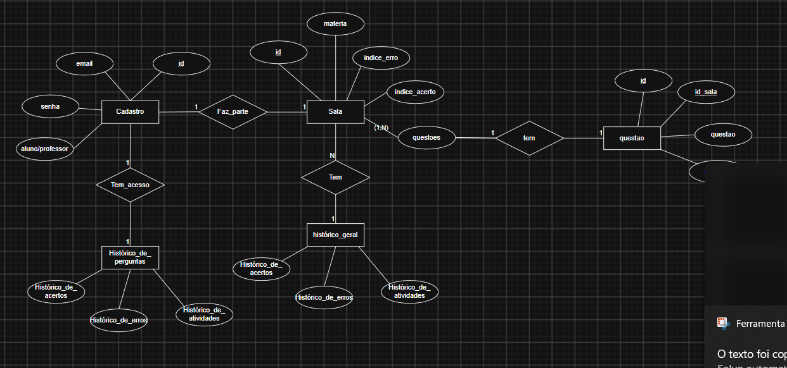
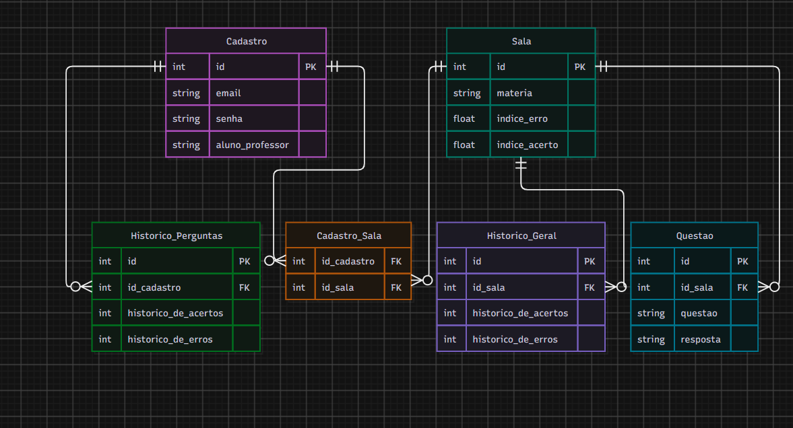

# 1ª Sprint

## Contribuições
Felipe: link do bd com o back, criação de algumas tables e principal, organização e socialização das ideias principais do banco de dados

Bruno: criação do der mer logico e conceitual

Guilherme: concertando as conexões tanto do bd e do back, ciração inicial de alguns CRUDS

Vitor: Organização e Socialização das ideias principais para o banco de dados e back end, criação da base para o projeto

Pietro: Estava realizando atividade avalitiva

## Imagens (MER DER)

## Status

Atrasado

### Justificativa

O prazo para a realização e enviu o sprint era até: 15/10, entrega real: 22/10, os dois dias da semana forem não letivos para o SENAI, 1 dos desenvolvedores estava ocupado com uma atividade avaliativa e o professor ocupado para resolver as principais duvidas.